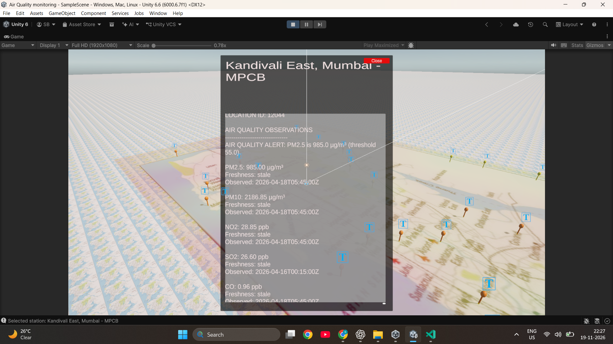

# Smart Air Quality Monitoring for Mumbai

A real-time air-quality monitoring project for Mumbai that combines a FastAPI
service with a Unity digital map. Station markers show PM2.5 conditions, an
interpolated pollution heatmap shows spatial patterns, and the map refreshes
live observations automatically. Configurable PM2.5 thresholds trigger station
alerts in the map and station details panel.



## Project structure

- `backend/` — FastAPI endpoints, OpenAQ integration, and the station dataset.
- `unity/` — Unity client project, including scenes, scripts, assets, packages,
  and project settings.

## Run the backend

In PowerShell, open the backend folder, create and activate its virtual
environment, install dependencies, set the OpenAQ key, and start the API in the
same terminal session:

```powershell
cd backend
python -m venv venv
.\venv\Scripts\Activate.ps1
pip install -r requirements.txt
$env:OPENAQ_API_KEY = "your OpenAQ API key"
python -m uvicorn app.main:app --host 127.0.0.1 --port 8000 --reload
```

API documentation is available at `http://127.0.0.1:8000/docs`.

## Open the Unity client

Open the `unity/` directory in Unity Hub. The project uses the Unity version
listed in `unity/ProjectSettings/ProjectVersion.txt`. Unity creates local editor
files such as `Library/` when it opens the project.
